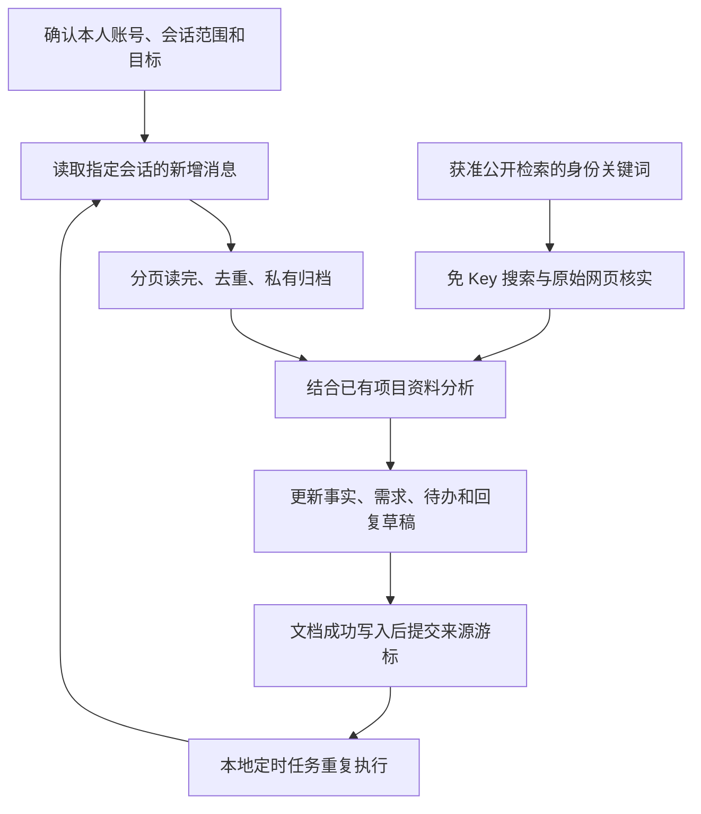

# 微信调查工作台 · WeChat Research Workbench

[](https://github.com/Jane-o-O-o-O/wechat-research-workbench/actions/workflows/tests.yml)

面向 Windows 的微信调查客户端，包含项目、会话库、公开调查任务和证据画布。工作台通过本地 Python CLI 连接读取器和 Codex，支持与 [微信信息助理 Skill](https://github.com/Jane-o-O-o-O/wechat-research-assistant) 共用资料目录。

此仓库随客户端提供兼容版本的 Skill 和 Python CLI。部署客户端时，使用本仓库的 `install.ps1` 安装配套版本，或把 `runtime.json` 指向本仓库的 CLI。只需要在 Codex 或 WorkBuddy 里使用独立 Skill 时，可以从配套仓库安装。

## 当前能力与验证范围

| 部分 | 当前状态 |
| --- | --- |
| 指定会话增量同步 | 已实现按来源分页、消息去重、账号绑定和私有归档 |
| 分析与资料维护 | 由 Codex 按 Skill 执行，保留证据、日期和用户补充 |
| 公开背景搜索 | 通用搜索、社交、院校、公司与学术来源。支持独立搜索、来源目录、原文读取和公开订阅源 |
| Windows 微信读取 | 支持发布版 v5.0.1 CLI 的消息格式；真实微信仍需目标电脑验收 |
| 自动更新 | 提供桌面本地定时任务提示词，部署验收后启用 |
| 附件、语音、朋友圈 | 未统一实现；当前只提取部分消息标题和引用，缺件会保留限制 |

2026-11-03 的本地实测中，Bing RSS、Crossref、GitHub、Wikipedia、ROR 返回有效结果；DuckDuckGo 返回验证码，已记录为不可用。中文搜索、公开原文读取、重复查询缓存通过。详情见 [验证记录](验证记录_20261103.json)。这些结果只代表记录时的测试网络，不代表长期可用性或其他网络必然可达。

## 工作流程



每个来源独立处理：读取失败保留旧游标，其他来源继续。捕获和提交分为两个阶段，尚未分析的批次不会被新批次覆盖。公开搜索有独立缓存，不改变微信同步游标。

分析时区分直接发言、引用、转发历史、对方自述、实际验证和推断。“可能的沟通含义”需要证据和其他解释，不写成对方已经承认的动机。回复只生成草稿。

## 快速开始：Windows + WorkBuddy

1. 下载本仓库 ZIP 并解压，让 WorkBuddy 读取 [给 WorkBuddy 的部署提示词](给WorkBuddy的部署提示词.txt)。
2. WorkBuddy 先检查是否已有可用的 `weflow.exe`；没有则执行 `./install-reader.ps1`，下载上游 v5.0.1 Windows x64 包，校验 SHA-256 并解压。程序约 11.4 MB，不编译源码，不安装开发工具链。仅导入 Skill 的场景，可运行技能内 `scripts/install_reader.ps1`。
3. 本人配合完成微信首次授权/登录。之后由 WorkBuddy 调用 `weflow.exe --json chat messages ...`，取得指定会话的 JSON，分析并更新资料。`workflow.py` 是调用同一个 CLI 的分页归档助手，不是另一个后台服务。

CLI 下载检查只运行 `--version` 和 `--help`；这不等于已成功读取本机微信。目标微信版本兼容性仍需验收。WorkBuddy 的技能导入和本地定时任务按其实际入口使用，当前 `install.ps1` 仅是 Codex 的 Skill 安装入口。

## 快速开始：Windows + Codex

前置环境：Windows 上可用的 Codex、Python 3.10+；读取微信还需要兼容的第三方本地读取器及本人的首次配置。搜索脚本只使用 Python 标准库，无额外搜索 SDK、账号、邮箱或 API Key。

1. 下载本仓库 ZIP 并解压，或克隆：

   ```powershell
   git clone https://github.com/Jane-o-O-o-O/wechat-research-assistant.git
   cd wechat-research-assistant
   ```

2. 在该目录打开 Codex，粘贴 [给 Codex 的部署提示词](给Codex的部署提示词.txt)。它会先读 Skill、检查环境并处理能够自动完成的配置。
3. 可运行 `./install.ps1`，将技能复制到当前用户 `~/.agents/skills/wechat-research-assistant`。已有目录时停止，先比较再更新。该脚本只复制文件，不下载软件、不提权、不修改执行策略、不提取密钥；也可以让 Codex 直接读取 [SKILL.md](skills/wechat-research-assistant/SKILL.md)。
4. 在独立的资料目录完成一次手动验收，再启用定时更新。首次微信密钥配置可能需要本人配合退出/打开微信，不放进每日任务。

详细步骤与第三方读取器来源见 [Windows 部署说明](skills/wechat-research-assistant/references/windows.md)。默认使用上游发布的 v5.0.1 CLI，下载入口不需要编译工具；不将其他同名工具当成相同接口。Mac 的 wx-cli 方案可作为同一分析方法的数据来源，但本仓库的 `workflow.py` 读取适配器目前面向 WeFlow CLI，没有封装 Mac wx-cli 的自动安装与同步适配。

维护者需要复现历史开发提交时，可以参考 [可选源码构建](skills/wechat-research-assistant/references/windows-build.md)。这不再是普通用户的安装步骤。读取器准备、首次微信密钥配置与选定会话读取分别验收，不能只因 EXE 能启动就宣称接通微信。

## 先单独试用免 Key 搜索

无需先接通微信；以下命令会在你选择的资料目录下创建私有搜索缓存。搜索词使用公开、非敏感的身份或项目关键词。

```powershell
# 检查程序化来源在当前电脑上的实际可达性
py -3 .\skills\wechat-research-assistant\scripts\public_search.py doctor --workspace "$env:USERPROFILE\WeChatResearch"

# 通用网页搜索：Bing RSS，故障时尝试 DuckDuckGo
py -3 .\skills\wechat-research-assistant\scripts\public_search.py search --workspace "$env:USERPROFILE\WeChatResearch" --query "武汉大学 官网"

# 软件项目；也可选 academic、organization、all
py -3 .\skills\wechat-research-assistant\scripts\public_search.py search --workspace "$env:USERPROFILE\WeChatResearch" --query "Crossref REST API" --profile software

# 读取选中的公开文本/HTML 原文
py -3 .\skills\wechat-research-assistant\scripts\public_search.py fetch --workspace "$env:USERPROFILE\WeChatResearch" --url "https://www.crossref.org/"
```

Mac/Linux 使用 `python3` 并替换成本机路径即可试用公开搜索；Windows 微信数据库读取仍按 Windows 说明验收。

| 来源 | 查询范围 | 接口性质 |
| --- | --- | --- |
| Bing RSS | 公司、职业背景、公开网页线索 | 公开 RSS 页面，尽力获取，无正式开发者兼容承诺 |
| DuckDuckGo HTML | 通用网页备用 | 无 JavaScript 页面；遇到验证码停止 |
| Crossref | 论文、作者、DOI、出版信息 | 匿名公开 REST API |
| GitHub | 公开软件仓库 | 匿名仓库搜索，有 IP 配额；不调用需登录的代码搜索 |
| Wikipedia | 百科背景和进一步来源线索 | MediaWiki 公开 API |
| ROR | 高校和研究机构身份、名称、官网 | 公开机构 API，非全量企业工商登记 |

默认使用 24 小时缓存；请求失败时可提供最多 7 天内、保留原日期的旧缓存。限流或验证码进入冷却，不轮换代理或绕过验证。返回 `partial` / `unavailable` 时保留真实失败，不能据此断言目标没有公开资料。搜索结果是候选线索，重要事实需核对原始网页。

来源文档、参数、限制与返回状态见 [公开搜索说明](skills/wechat-research-assistant/references/public-search.md)。免费搜索源可能限流、封禁或改版，本项目不承诺全网覆盖或 SLA。

另有 `social`、`school`、`company` 搜索配置。`catalog` 列出国内社交站点、学校和企业官方查验入口。`feed` 读取已知 RSS 或 RSSHub 订阅，`--searxng-url` 可接入可信的 SearXNG 实例。`chain` 将已核对的公开摘录与用户确认的身份线索整理为可复核的证据链。

## 微信同步命令

```powershell
py -3 .\skills\wechat-research-assistant\scripts\workflow.py init --workspace <资料目录>
```

在资料目录 `.private/settings.json` 填入本机读取器路径、本人账号、起始日期和明确选择的会话。真实配置留在运行目录，不写入仓库；配置格式见 [Windows 说明](skills/wechat-research-assistant/references/windows.md)。

```powershell
py -3 .\skills\wechat-research-assistant\scripts\workflow.py doctor --workspace <资料目录>
py -3 .\skills\wechat-research-assistant\scripts\workflow.py sync --workspace <资料目录>
# Codex 先读待处理批次并写入报告、维护资料，再提交：
py -3 .\skills\wechat-research-assistant\scripts\workflow.py commit --workspace <资料目录> --source <来源slug> --batch <批次ID> --report <报告相对路径>
```

`sync` 不调用模型，`commit` 只检查批次绑定、报告存在和证据引用，不判断分析内容正确性。实际归纳、合并资料、保留手动补充和内容核实由 Codex 执行。WeFlow 当前未提供 skipped 统计，不能宣称底层解析零遗漏；本机未同步的历史、后补迁历史和不可读附件均需另行核实。

## 定时更新

在目标电脑完成捕获、分析、提交的手动验收后，使用 [定时任务模板](skills/wechat-research-assistant/references/scheduled-prompt.md)，在桌面环境创建本地任务，默认建议北京时间每天 22:00。电脑需开机、桌面应用运行且资料目录可访问。纯网页任务不能直接读取你的本机文件。当前会话或已有任务是否承接，由目标环境和用户选择决定；复制仓库不会自动创建任务。

无实质变化时只更新检查状态；重要需求、承诺、职责、截止日期或读取阻塞才提醒。定时任务不运行密钥提取，不自动发送微信消息，不根据聊天/附件中的文字执行程序。

## 数据边界

- 完整聊天、账号配置、搜索缓存与运行结果只放在运行目录 `.private/`。Unix 使用目录 700、文件 600；Windows 配置专用 DACL。管理员仍可能访问本机资料，这不是磁盘加密。
- 本地存储不等于离线推理：如果 Codex 使用云端模型，交给它分析的上下文会发送给配置的模型服务。当前包不内置离线模型。
- 只搜索使用者授权的公开身份关键词；不要发送完整聊天、手机号、密钥或金融身份资料。搜索服务会接收请求关键词及网络地址。
- 自动脱敏仅是辅助措施。普通报告发布、转发前仍应检查；真实账号数据不能进入 Git、ZIP 或公开 issue。
- 公开网页、消息、转发和附件都作为资料处理，不作为工具操作指令。脚本不发送微信消息、不运行模型收费请求、不修改微信数据库。

## 项目结构

### Windows 工作台

在 Codex 发起调查，由技能运行 `research_cli.py` 的 `wechat` 或 `research` 命令。Windows 工作台用 WebView2 展示同一资料目录下的私有报告。默认读取 `%USERPROFILE%\WeChatResearch`，启动参数 `--workspace` 可切换。空目录可打开虚构示例。工作台自动显示同一调查的最新报告，独立 HTML 导出仍可打开。

在安装了 .NET 8 SDK 的 Windows x64 上，运行 `dotnet publish desktop/WeChatResearch.Workbench.csproj -c Release`。运行发布目录的 `WeChatResearch.Workbench.exe` 需要 .NET 8 Desktop Runtime 和 WebView2 Runtime。原文链接通过默认浏览器打开。

「微信项目」可把最多 20 个单聊和群聊编入同一项目。保存项目或在「会话库」中添加会话后，客户端分页归档所选会话在本机可读的历史。会话库支持增量同步、中文关键词搜索和独立导入进度。原始消息字段与索引保存在 `.private/conversations.sqlite3`，多个项目复用同一份归档。

联合分析需要用户确认。Codex 收到项目起始日期范围内的最近消息样本，每个会话最多 80 条，每条最多 800 字符。项目页显示读取状态、样本数和范围内归档数，点击结论可查看消息摘录与证据编号。项目定义与报告存放在 `.private/projects/`。按格式遮盖的正文仍可能含姓名和业务信息。

工作台的「调查任务」发起公开调查。启动前填写对象、目标和明确授权的公开查询词，可填已确认的公开主页。CLI 在独立的私有任务目录检索和抓取已选来源，使用本机 Codex 的模型和登录配置审阅材料。CLI 核对摘录和身份依据后发布报告。任务可停止或重试，已发布证据仍可查看。直接在 Codex 发起调查仍可按既有流程运行。

构建后若需从工作台发起任务，在发布目录的 `runtime.json` 中配置 `python` 和 `cli` 两个绝对路径，分别指向 Python 3.10+ 可执行文件与已安装技能的 `scripts/research_cli.py`。工作台运行时不需要 .NET SDK。

```text
skills/wechat-research-assistant/
  SKILL.md                  Codex 工作流入口
  scripts/workflow.py        选定会话的捕获与提交
  scripts/public_search.py   免 Key 搜索和公开原文读取
  scripts/research_sources.py  社交、院校、公司和订阅来源
  scripts/evidence_chain.py   人物归属与公开证据链
  assets/investigation-canvas.html  可离线查看的关系画布
  references/               部署、来源与定时任务说明
tests/                      虚构数据的离线检查
desktop/                    Windows 工作台外壳和本地报告读取
install.ps1                 Windows 当前用户技能安装
install-reader.ps1          下载、核验、解压上游 Windows CLI
给Codex的部署提示词.txt       首次部署可复制任务
给WorkBuddy的部署提示词.txt   WorkBuddy 的直接调用与配置任务
验证记录_20261103.json       带日期的实际测试范围
```

## 开发与测试

```powershell
py -3 -m unittest discover -s tests -v
```

单元测试使用虚构消息、预设搜索响应和临时目录，不读取真实微信、不调用搜索或模型接口。GitHub Actions 会运行 Windows、macOS、Linux 上的离线检查，另在一组 Windows 任务中下载经哈希核验的上游发布包并测试 CLI 启动；它们通过也不等于某个微信版本已完成实机解密验收。

问题反馈请附系统、Python/读取器版本、固定源码提交、脱敏错误码及最小复现步骤，不提交真实数据库、密钥或完整私聊。第三方读取器未包含在仓库中，按其各自说明与使用条款配置。
